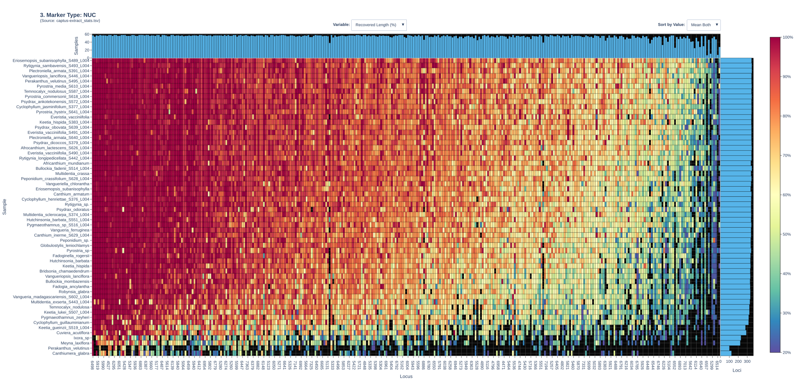
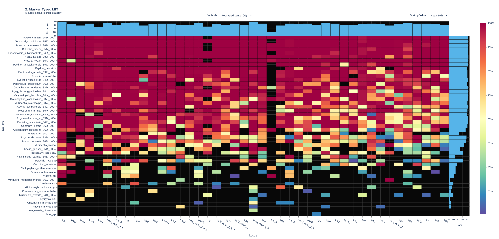
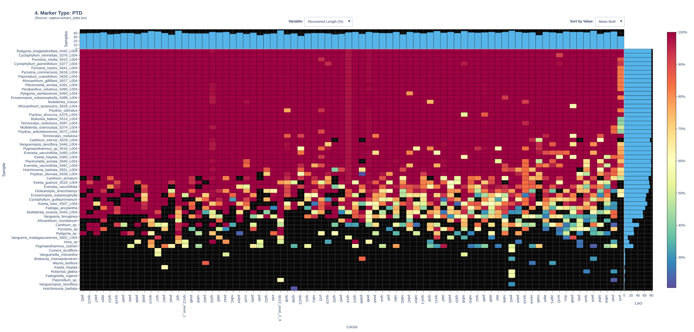

```{r}
#| echo: false
#| label: paths

path_project <- "//wsl.localhost/Ubuntu/home/frieda/Projects/Vanguerieae/CleanedData/"

path_gf_nuc <- paste0(path_project, "05_phylogeny_flanking/")
path_nt_org <- paste0(path_project, "05_phylogeny_NT_iqtree3/")
```

```{r}
#| echo: false
#| label: libs


library(dplyr)
library(ape)
library(phytools)
library(treeio)
library(ggtree)
library(stringr)
library(scatterpie)
library(ggnewscale)
library(viridis)
library(ggtern)

```

```{r}
normalize_me <- function(x) {
  x_norm = (x-min(x))/(max(x)-min(x))
  return(x_norm)
}
```

### Taxonomic summary:

Note: Numbers of accepted species is based on @WFO2026

| Rank      | Scientific Name                        | Accepted species |
|-----------|----------------------------------------|------------------|
| Order     | Gentianales Juss. ex Bercht. & J.Presl | 23,438           |
| Family    | Rubiaceae Juss.                        | 14,256           |
| Subfamily | Dialypetalanthoideae Reveal            | 5,956            |
| Tribe     | Vanguerieae Dumort.                    | 674              |

# Materials & Methods

### Data summary:

The project combines Angiosperm353 [@Johnson2019Angiosperms353] sequence data from three different sources. The tribe Vanguerieae comprises 28 currently accepted genera [@WFO2026].

> [***\[NOTE\] TO DO:***]{.underline} double-check number of genera in the data sets for ACCEPTED species names

| ID | Dataset | \# Samples | \# Genera | Sampled species per genus | Samples per species | \% of all accepted genera |
|-----------|-----------|-----------|-----------|-----------|-----------|-----------|
| 1 | Catarina | 30 | 17 \[check\] | 1-3 | A single replicate[^1]. | 60.7% |
| 3 | PAFTOL | 31 | 28 \[check\] | 1-2 | single replicate | 90.3% |
| 2 | Frieda | 17 | 16 \[check\] | 1 | single replicate | 57.1% |
|  | **Total** | 78 | 28 | 1-6 | 1-3 | 100% |

[^1]: Exception: Two replicates for *Everistia vacciniifolia (=Psydrax vacciniifolius)* and *Plectroniella armata (=Canthium armatum)*

## Sampling

Plant tissue material for datasets 1 and 2 was collected from herbarium materials or silica-collections (see supplementary for references for all samples).

## Target Capture

[MyBaits]{.smallcaps} Angiosperm353 baits kit

## Bioinformatics

The majority of the bioinformatics pipeline was developed in [bash]{.smallcaps} language in a dedicated [conda]{.smallcaps} environment. The majority of tasks were performed using the published [captus]{.smallcaps} pipeline [@Ortiz2026Cucurbitales].

### Data retrieval

Sequence data published through the European Nucelotide Archive (ENA) from the PAFTOL project [@Baker2022PAFTOL] were accessed and retrieved on October 23, 2026. Accession numbers can be found in the supplementary.

### Quality control and sequence cleaning

#### [Trimming]{.underline}

We used the [captus]{.smallcaps} function `captus clean` using the flag `--qc_program fastqc` . [captus]{.smallcaps} uses [bbduk.sh]{.smallcaps} from [BBTools]{.smallcaps} [@Bushnell2014BBMap] with specific settings that balance speed and accuracy. The [BBTools]{.smallcaps} approach in [Captus]{.smallcaps} has been compared to other frequently used software for trimming and was by far the fastest and most accurate approach. More accurate was only [Cutadapt]{.smallcaps} [@Martin2011Cutadapt] but it took more than 23x longer. The increase in accuracy using [Cutadapt]{.smallcaps} was minimal compared to [captus]{.smallcaps} (perfectly correct trimming of bases: 96.9 % vs. 95.1%) Faster was only [bbduk]{.smallcaps} with default setting but it was less accurate (93.9% perfectly correct trimming of bases). For details, please refer to their [documentation](https://edgardomortiz.github.io/captus.docs/assembly/clean/).

#### [QC]{.underline}

In the end, we evaluated the results using FastQC [@Andrews2019FastQC] as implemented in [Captus.]{.smallcaps}

### De-Novo Assembly

We used the [captus]{.smallcaps} function `captus assemble` with default options for de-novo assembly of raw trimmed reads into overlapping contigs.

In contrast to other commonly used tools and software (e.g., [HybPiper]{.smallcaps}) [@Johnson2016HybPiper], [captus]{.smallcaps} performs de-novo assembly into contigs using [MEGAHIT]{.smallcaps} [@Li2015MEGAHIT; @Li2016MEGAHITv1] before mapping the reads to a target sequence. This means that MEGAHIT combines information of overlapping reads into contigs. MEGAHIT is fast and memory efficient due to the use of succint De Bruijn Graph (sDBG) data structures. For detailed accurate calculations of contig depth of coverage [Salmon]{.smallcaps} (v 1.10.3) [@Patro2017Salmon] is used and contigs with less than 1.5x coverage are automatically removed.

De-novo assembly increases the recovery and decreases the reference bias, especially for sequences that are not phylogenetically close to the sequences used in bait design. Comparing de-novo assembled contigs to the reference sequence is beneficial as it compares more complete loci, fewer missing bases, and longer sequences compared to using raw reads. In addition, it increases the recovery of non-baited sequences (off-target nuclear genes, plastomes, non-coding regions).

### Mapping and extracting reference markers

Next, [captus]{.smallcaps} uses [Scipio]{.smallcaps} [@Keller2008Scipio] for coding sequences of nuclear targets and [BLAT]{.smallcaps} [@Kent2002BLAT] for any other kind of target sequence to search and extract the reference sequences within the assembled contigs. The reference can be chosen by the user. We use the [captus]{.smallcaps} function `captus extract` with the flags `-n Mega353` `-p SeedPlantPTD` and `-m SeedPlantMIT`, which are three different references for nuclear (Mega353) [@McLay2021NewTargets], plastome (PTD) and mitochondrial (MIT) sequences. The Mega353 dataset contains multiple reference sequences per genes coming from a larger sample of clades, thereby increasing hits for sequences which are distant to the original target sequences. The two organellar datasets are a set of proteins across all seed plants curated by [Captus]{.smallcaps}.

### Alignment

We aligned the extracted markers using the [captus]{.smallcaps} function `captus align` with the flags `-m ALL` `-f ALL` `–-filter_method informed` `–-clipkit_method smart-gap` . [captus]{.smallcaps} first gathers all markers across all samples and uses the reference database for assisted alignment as a guide. By default, the function uses [MAFFT]{.smallcaps} [@Katoh2002MAFFT] with automatic model selection for the alignment. The flags `-m ALL` chooses all marker types for alignment (nuclear, plastome, mitochondrial) and `-f ALL` creates output in the formats: 1) coding sequences in amino acids, 2) coding sequences in nucleotides, 3) complete genes (intros + exons) without flanking regions, 4) complete genes with flanking regions. Nucleotide markers are aligned using the amino acid alignment as a template to take into account codons for the alignments. After alignment, the function also filters paralogs, trims erroneous stretches using [TAPER]{.smallcaps} [@Zhang2021TAPER], and then removes the gaps in columns with [ClipKIT]{.smallcaps} [@Steenwyk2020ClipKIT].

The flag `--filter_method informed` selects a method for handling paralogs. The method "informed" keeps only a single copy of the paralog and it is the copy that is most similar to the reference sequence that was most frequently chosen across all samples in the alignment. This method benefits from multiple reference sequences per locus while disregarding the ranking of best hits.

The flag `--clipkit_method smart-gap` selects the clipping method for gappy columns to dynamically determine the threshold for gaps (the recommended trimming mode in [ClipKIT]{.smallcaps}).

## Phylogenomic inference

We used the aligned genes with flanking regions for phylogenomic inference for concatenation and MSC approaches for maximum likelihood phylogenetic inference, but repeated the organelle-inference with the aligned nucleotides as well as these alignments showed slightly more informative sites in some cases when compared to the genes with flanking regions. The aligned nucleotides are codon-aware and only include exons as they were aligned using the amino acid alignment as guide.

### A) Summary trees using concatenation in IQ-TREE

We used partition models [@Chernomor2016Terrace] and performed automated model selection for substitution models in [iqtree]{.smallcaps} version 3.1.4 [@Wong2026IQTREE3]. We used the following flags for nuclear, plastid and mitochondrial markers: `-m MFP` `--ufboot 1000` which selects the extended model selection using [modelfinder]{.smallcaps} [@Kalyaanamoorthy2017ModelFinder] that also includes free rate models and is immediately followed by tree reconstruction using the best model. This was performed using ultra fast bootstrap (UFBoot) [@Hoang2018UFBoot2] with 1000 replicates.

As a second approach we performed a maximum likelihood phylogenetic analysis using automated model selection, partition merging, and ultra fast bootstrap support estimation. Specifically, we used an edge-linked proportional partition model as recommended by [iqtree3]{.smallcaps}. Compared to the edge-linked equal branch-length partition model and the edge-unlinked partition model, the proportional branch-length model allows partitions to differ in their overall evolutionary rates while retaining proportional branch lengths across the shared tree, thereby creating a reasonable compromise between flexibility and parameter complexity.

\
For this we used the flags `-p` with the folder of individual alignments per extracted marker, `-m MFP+MERGE` for [modelfinder]{.smallcaps} comparison and partition merging, and `--ufboot 1000` to perform 1000 ultra fast bootstrap repetitions. [iqtree3]{.smallcaps} then combines the individual gene alignments into a supermatrix where each gene is then initially treated as a separate partition.

The benefits of partition merging is that it allows for different substitution rates across partitions (i.e., different genetic markers) while still assuming a shared underlying tree topology across the partitions. Different genes may be more or less evolutionarily conserved and thereby evolve under different processes. Assuming the same substitution model across these different regions of the genome may not adequately represent these differences. Our approach instead let's [modelfinder]{.smallcaps} as implemented in [iqtree3]{.smallcaps} evaluate a set of up to 268 models for each partition (i.e., alignment file in the folder) while the merging algorithm evaluates whether partitions can be combined under the same substitution model to decrease the number of substitution models to estimate. Model selection was then performed using the Bayesian Information Criterion (BIC) to avoid overfitting to more complex models. Overall this approach reduces overparameterization by combining partitions with similar evolutionary characteristics, improves the computational efficiency because fewer partitions and model parameters reduce computational time and memory requirements, balances model complexity and statistical fit by aiming to retain biologically relevant differences while avoiding unnecessary complexity and is hence particularly valuable for concatenated datasets containing many genes.

### B) MSC-aware inference of a species tree from nuclear gene trees in wASTRAL

First we inferred gene trees again using [iqtree3]{.smallcaps} in a similar manor as we did for concatenated trees. We then prepared the individual gene trees for use in ASTRAL [@Zhang2025ASTER], namely we concatenated all gene.treefiles into a single newick file which was then used as input for ASTRAL. We used the weighted-ASTRAL algorithm using the `wastral` function with in the software package ASTER with `--mode 1` for hybrid weighing. Support values at the nodes indicate LPP. We first computed the species tree using individual replicates as they were at the tips to identify potential specimens that have been misidentified based on how replicates clustered together with their own species. We then used the more sophisticated approach of mapping individual replicates to their species name and thereby estimating the phylogeny for a single tip per species that is based on the information provided by multiple replicates.

### Concordance factor analysis

To quantify the genealogical concordance between individual genes and the species tree, we used the concordance factor analysis as implemented in [iqtree3]{.smallcaps} [@Mo2023SCF]. Two measures are reported for each branch in a common reference tree: 1) gene concordance factors (gCF) and 2) site concordance factors (sCF). The two metrics are defined as the percentage of decisive gene trees containing the branch (gCF), and as the percentage of decisive alignment sites supporting a branch (sCF). While gCF is useful when individual gene alignments are informative, sCF can recover concordance when individual gene trees are uncertain. Both measures are used together with classical branch support measures (e.g. ufboot) to complement the branch support with a full description of the underlying disagreement among loci and sites.

For both measures, a species tree that can be used as reference has to be inferred first. We used the concatenation-based species trees created in [iqtree3]{.smallcaps} under an edge-linked proportional partition model with 1000 ufboot replicates.

Next, gene trees are requires for gCF. We again used [iqtree3]{.smallcaps} with the flag `-S` to estimate these individual gene trees including model selection and tree inference for each alignment/loci. Given these individual gene trees and the reference species tree, we calculated gCF for each branch of the species tree as a fraction of the decisive gene trees that are in agreement with this branch using the flag `–-gcf`.

Site concordance factors as implemented in iqtree3 with the flag `--scfl` is based on likelihood (as opposed to parsimony like gCF). We used the same reference species tree as for gCF and randomly sampled 1000 quartets around each branch to estimate sCF values. The program then again performs model selection and tree inference.

> Overall, the concordance factor analysis in [iqtree3]{.smallcaps} [@Mo2023SCF] revealed that high bootstrap support values do not correspond to high concordance. For organelle markers, the two main reasons for high discordance were 1) not enough decisive phylogenetic information and 2) polyphyletic discordance (gDFP), indicating that the gene trees themselves were poorly resolved due to not enough phylogenetic information in the sequences.

We investigated the concordance of gene trees with the species tree using quartet scores for the MSC tree. For this we inferred individual gene trees from each gene alignment using the [iqtree]{.smallcaps}3 flag `-S` and removed the merging algorithm to quantify the agreement with the original genes instead of partitions.

# Results

## Data quality

#### [Trimming]{.underline}

Trimming using [bbduk.sh]{.smallcaps} within [captus]{.smallcaps} removed between 1.07% and 9.74% of reads (equivalent to 2.5% and 46.89% of all bases, thereby retaining between 99.2% and 58.8% of the mean read length. The proportion of ≥Q30 reads varied from 99.75% to 93.77%. Overall, quality of sequences of dataset 3 was lower than the quality of dataset 1 which was overall excellent. The sample with the lowest quality and highest degree of trimming was *Meyna laxiflora* (dataset 3), which also contained 72% of adapters. Contamination was overall low across the sequences included here.

## De-Novo Assembly

Mean contig depth of coverage varied over four magnitudes (1,357.28x in *Afrocanthium munndianum* (dataset 3) to 9.04x in *Ixora sp*. (dataset 3)) with the overall median being close to 40x.

The shortest contigs varied from 137 bp to 248 bp, while the longest contigs were between 464,750 bp and 969 bp. The longest contigs from dataset 1 were at least 8,104 bp long, while the majority of the longest contigs from dataset 3 were smaller than that.

## Mapping and extracting reference markers

Overall, recovery was high with exception of mitochondrial sequences which failed for 13 species, while recovery of plastome sequences only failed for 3 species.

{fig-align="center" width="4000"}

{fig-align="center"}



## Alignment

The resulting report created by [captus]{.smallcaps} showed that the extracted genes including flanking regions harboured this highest proportion of informative sites all three types of markers.

Visual inspection of a random subset of [10 alignments]{.underline} did not show any systematic errors.

> [***\[NOTE\] TO DO:***]{.underline} Increase number of visually inspected alignments

## Phylogenetic Inference

### A) Summary trees

Overall, support values were highest in the nuclear tree and branch lengths were close to zero in the plastome and the mitochondrial trees.

#### Nuclear genes

```{r}
#| fig-width: 6
#| fig-height: 12
#| echo: false
#| message: false
#| label: concat-nuc-treefile

nuc_tre <- 
  read.tree(paste0(path_gf_nuc, "concat_nuc.treefile")) %>%
  root(outgroup = "Ixora_sp") %>%
  ladderize()

support <- as.numeric(nuc_tre$node.label)

plotTree(nuc_tre, ftype = "i", xlim = c(0,1.25*max(nodeHeights(nuc_tre))))

cols <- ifelse(support >= 95, "darkgreen",
               ifelse(support >= 80, "orange", "red"))

nodelabels(
  pch = 21,
  bg = cols,
  cex = 1.2
)

cladelabels(nuc_tre, node = 109, "Psydrax", orientation = "horizontal")
cladelabels(nuc_tre, node = 60, "Afrocanthium", orientation = "horizontal")
cladelabels(nuc_tre, node = 62, "Keetia", orientation = "horizontal")
cladelabels(nuc_tre, node = 74, "Cyclophyllum", orientation = "horizontal")
cladelabels(nuc_tre, node = 73, "Peponidium", orientation = "horizontal")
cladelabels(nuc_tre, node = 72, "Bullockia", orientation = "horizontal")
cladelabels(nuc_tre, node = 73, "Peponidium", orientation = "horizontal")
cladelabels(nuc_tre, node = 108, "Perkanthus", orientation = "horizontal")
cladelabels(nuc_tre, node = 84, "Eriosemopsis", orientation = "horizontal")
cladelabels(nuc_tre, node = 81, "Canthium", orientation = "horizontal")
cladelabels(nuc_tre, node = 106, "Hutchinsonia", orientation = "horizontal")
cladelabels(nuc_tre, node = 104, "Temnocalyx", orientation = "horizontal")
cladelabels(nuc_tre, node = 93, "Pygmaeothamnus", orientation = "horizontal")
cladelabels(nuc_tre, node = 95, "Multidentia", orientation = "horizontal")
cladelabels(nuc_tre, node = 92, "Vangueriopsis", orientation = "horizontal")

```

Figure 4. Concatenation-based maximum likelihood species tree for Vanguerieae based on 353 nuclear genes including the flanking regions of the genes. Nodes are colored by ultra fast bootstrap support value. Green indicates the highest support (≥ 95), orange indicates intermediate support (≥ 80) and red indicates support \< 80. Species at the tips with numbers in their name are derived from dataset 1 and those without from dataset 3. "Ixora_sp" was used to root the tree. Note that the species names at the tips are the verbatim names from the herbarium vouchers. Some species have changed genus since:\
*Everistia vacciniifolia* = *Psydrax vacciniifolius\
Plectroniella armata* = *Canthium armatum\
Canthium parasiebenlistii* = *Afrocanthium parasiebenlistii* \[DATASET 2 not included yet\]

#### Plastome

```{r}
#| fig-width: 6
#| fig-height: 12
#| echo: false
#| message: false
#| label: concat-ptd-treefile
ptd_tre <- 
  read.tree(paste0(path_gf_nuc, "concat_ptd.treefile")) %>%
  root(outgroup = "Ixora_sp") %>%
  ladderize()

support <- as.numeric(ptd_tre$node.label)

plotTree(ptd_tre, ftype = "i")

cols <- ifelse(support >= 95, "darkgreen",
               ifelse(support >= 80, "orange", "red"))

nodelabels(
  pch = 21,
  bg = cols,
  cex = 1.2
)
```

Figure 5. Concatenation-based maximum likelihood species tree based on 80 plastome genes including the flanking regions of the genes. The tree contains only a subset (54 out of 58) taxa from the nuclear tree since the plastome recovery failed for some species. Nodes are colored by ultra fast bootstrap support value. Green indicates the highest support (≥ 95), orange indicates intermediate support (≥ 80) and red indicates support \< 80. Species at the tips with numbers in their name are derived from dataset 1 and those without from dataset 3. "Ixora_sp" was used to root the tree. Note that the species names at the tips are the verbatim names from the herbarium vouchers. Some species have changed genus since:\
*Everistia vacciniifolia* = *Psydrax vacciniifolius\
Plectroniella armata* = *Canthium armatum\
Canthium parasiebenlistii* = *Afrocanthium parasiebenlistii* \[DATASET 2 not included yet\]

#### Mitochondrial genes

We used site (sCF) and gene (gCF) concordance factor analysis as implemented in [iqtree]{.smallcaps}3 [@Mo2023SCF] on individual gene trees form mitochondrial markers. Gene concordance factor analysis revealed limited agreement between individual mitochondrial gene trees and the concatenated mitochondrial phylogeny. Many internal branches exhibited low gene concordance factors despite high bootstrap support in the concatenated analysis. For example, branches with bootstrap support of 92–99% included several with gene concordance factors below 12%. Discordance was predominantly classified as polyphyletic (gDFP), rather than as support for either of the two alternative nearest-neighbor interchange resolutions.

The number of decisive gene trees varied substantially among branches, and some apparently high concordance values were based on only a single decisive gene tree. Furthermore, many individual mitochondrial alignments contained relatively few parsimony-informative sites. Consequently, the observed differences among mitochondrial gene-tree estimates may reflect limited phylogenetic resolution and gene-tree estimation uncertainty. These findings indicate that the mitochondrial concatenated phylogeny is not consistently recovered by individual gene-tree estimates, although the biological significance of this discordance remains uncertain.

```{r}
#| fig-width: 6
#| fig-height: 12
#| echo: false
#| message: false
#| label: concat-mit-treefile
mit_tre <- 
  read.tree(paste0(path_gf_nuc, "concat_mit.treefile")) %>%
  ladderize()

support <- as.numeric(mit_tre$node.label)

plotTree(mit_tre, ftype = "i")

cols <- ifelse(support >= 95, "darkgreen",
               ifelse(support >= 80, "orange", "red"))

nodelabels(
  pch = 21,
  bg = cols,
  cex = 1.2
)
```

Figure 6. Unrooted concatenation-based maximum likelihood species tree based on 43 mitochondrial genes including the flanking regions of the genes. The tree contains only a subset (46 out of 58) taxa from the nuclear tree since the mitochondrial DNA recovery failed for some species. Nodes are colored by ultra fast bootstrap support value. Green indicates the highest support (≥ 95), orange indicates intermediate support (≥ 80) and red indicates support \< 80. Species at the tips with numbers in their name are derived from dataset 1 and those without from dataset 3. Note that the species names at the tips are the verbatim names from the herbarium vouchers. Some species have changed genus since: *Everistia vacciniifolia* = *Psydrax vacciniifolius Plectroniella armata* = *Canthium armatum\
Canthium parasiebenlistii* = *Afrocanthium parasiebenlistii* (DATASET 2 not included yet)

### B) MSC-aware inference of a species tree from nuclear gene trees in wASTRAL

#### Species tree (with map)

```{r}
#| echo: false
#| message: false
#| label: MSC-tree-mapped


tr <- 
  treeio::read.newick(
    paste0(
      path_gf_nuc, "species_tree_wASTRAL/wastral_MSC_species_tree_mapped.nwk"
      )
    ) %>%
  ladderize()

tree_df <- ggtree(tr)$data


# Extract ASTRAL statistics from node labels
tree_df <- tree_df %>%
  mutate(
    CU      = as.numeric(str_extract(label, "(?<=CULength=)[0-9\\.eE-]+")),
    localPP = as.numeric(str_extract(label, "(?<=localPP=)[0-9\\.eE-]+")),
    q1      = as.numeric(str_extract(label, "(?<=q1=)[0-9\\.eE-]+")),
    q2      = as.numeric(str_extract(label, "(?<=q2=)[0-9\\.eE-]+")),
    q3      = as.numeric(str_extract(label, "(?<=q3=)[0-9\\.eE-]+"))
  )

# Internal nodes with quartet information
nodes <- tree_df %>%
  filter(!isTip, !is.na(q1))


```

```{r}
#| echo: false
#| message: false
#| label: make-cu-branchlength

#Rebuild with CU as branch length

edge_df <- data.frame(
  parent = tr$edge[, 1],
  child  = tr$edge[, 2]
) %>%
  left_join(
    tree_df %>%
      select(node, CU),
    by = c("child" = "node")
  )

tr_cu <- tr

edge_lengths <- rep(0.05, nrow(tr$edge))

internal <- !is.na(edge_df$CU)

edge_lengths[internal] <- edge_df$CU[internal]

tr_cu$edge.length <- edge_lengths

```

```{r}
#| echo: false
#| message: false
#| fig-height: 12
#| label: plot-mapped-msc-tree

p <- ggtree(tr_cu)

# Incl. tips 
pdat <- p$data %>%
  mutate(
    branch_mid = x - branch.length / 2
  )

# Nodes only
nodes <- p$data %>%
  filter(!isTip) %>%
  mutate(
    CU = as.numeric(str_extract(label, "(?<=CULength=)[0-9\\.]+")),
    localPP = as.numeric(str_extract(label, "(?<=localPP=)[0-9\\.eE-]+")),
    q1 = as.numeric(str_extract(label, "(?<=q1=)[0-9\\.]+")),
    q2 = as.numeric(str_extract(label, "(?<=q2=)[0-9\\.]+")),
    q3 = as.numeric(str_extract(label, "(?<=q3=)[0-9\\.]+"))
  )


## ALL

tree_nodes <- pdat %>%
  filter(!isTip) %>%
  left_join(
    nodes %>% select(node, q1, q2, q3, localPP),
    by = "node"
  ) %>%
  mutate(
    discordance = 1 - q1
  ) %>%
  mutate(
    pie_size = case_when(
      q1 < 0.4 ~ 0.3,
      q1 < 0.6 ~ 0.2,
      q1 < 0.8 ~ 0.01,
      TRUE ~ 0.3
    )
  )


p_cu<-  ggtree(tr_cu) +
  coord_cartesian(clip = "off") +
  xlim(0, max(nodeHeights(tr_cu)) * 3) +
  theme(
    plot.margin = margin(0, 20,0 , 20)
  )+
  geom_tree() +
  geom_tiplab(
    aes(label = gsub("_", " ", label)),
    fontface = "italic",
    size = 4,
    offset = 0.8,
    align = FALSE
  ) +
  geom_text2(
    data = tree_nodes,
    aes(
      subset = !isTip,
      x = branch_mid,
      label = sprintf("%.2f", branch.length)
    ),
    nudge_y = -0.4,
    size = 3
  ) +
  geom_text2(
    data = filter(tree_nodes, !isTip & !is.na(localPP) & localPP < 1.00),
    aes(label = sprintf("%.2f", localPP)),
    color = "red",
    size = 3,
    nudge_y = 0.8
  ) +
  geom_scatterpie(
    data = tree_nodes %>% filter(q1 < 0.4),
    aes(
      x = x,
      y = y,
      r = 0.3
    ),
    cols = c("q1","q2","q3"),
    color = "black",
    alpha = 0.8
  )+
  scale_color_viridis_c(
    limits = c(0.9, 1),
    oob = scales::squish
  )+
  theme_tree2() +
  xlab("Coalescent units")+
  coord_equal() +
  scale_fill_discrete(palette = "RdYlBu")
  
  
  p_cu 
```

\


------------------------------------------------------------------------

#### Replicates tree (without map)

```{r}
#| echo: false
#| message: false
#| msc-tree-no-map

tr <- 
  treeio::read.newick(
    paste0(
      path_gf_nuc, "species_tree_wASTRAL/wastral_MSC_species_tree_no_map.nwk"
      )
    ) %>%
  ladderize()
tree_df <- ggtree(tr)$data


# Extract ASTRAL statistics from node labels
tree_df <- tree_df %>%
  mutate(
    CU      = as.numeric(str_extract(label, "(?<=CULength=)[0-9\\.eE-]+")),
    localPP = as.numeric(str_extract(label, "(?<=localPP=)[0-9\\.eE-]+")),
    q1      = as.numeric(str_extract(label, "(?<=q1=)[0-9\\.eE-]+")),
    q2      = as.numeric(str_extract(label, "(?<=q2=)[0-9\\.eE-]+")),
    q3      = as.numeric(str_extract(label, "(?<=q3=)[0-9\\.eE-]+"))
  )

# Internal nodes with quartet information
nodes <- tree_df %>%
  filter(!isTip, !is.na(q1))


```

```{r}
#| echo: false
#| message: false

#Rebuild with CU as branch length

edge_df <- data.frame(
  parent = tr$edge[, 1],
  child  = tr$edge[, 2]
) %>%
  left_join(
    tree_df %>%
      select(node, CU),
    by = c("child" = "node")
  )

tr_cu <- tr

edge_lengths <- rep(0.05, nrow(tr$edge))

internal <- !is.na(edge_df$CU)

edge_lengths[internal] <- edge_df$CU[internal]

tr_cu$edge.length <- edge_lengths

```

```{r}
#| echo: false
#| message: false
#| fig-height: 12

p <- ggtree(tr_cu)

# Incl. tips 
pdat <- p$data %>%
  mutate(
    branch_mid = x - branch.length / 2
  )

# Nodes only
nodes <- p$data %>%
  filter(!isTip) %>%
  mutate(
    CU = as.numeric(str_extract(label, "(?<=CULength=)[0-9\\.]+")),
    localPP = as.numeric(str_extract(label, "(?<=localPP=)[0-9\\.eE-]+")),
    q1 = as.numeric(str_extract(label, "(?<=q1=)[0-9\\.]+")),
    q2 = as.numeric(str_extract(label, "(?<=q2=)[0-9\\.]+")),
    q3 = as.numeric(str_extract(label, "(?<=q3=)[0-9\\.]+"))
  )


## ALL

tree_nodes <- pdat %>%
  filter(!isTip) %>%
  left_join(
    nodes %>% select(node, q1, q2, q3, localPP),
    by = "node"
  ) %>%
  mutate(
    discordance = 1 - q1
  ) %>%
  mutate(
    pie_size = case_when(
      q1 < 0.4 ~ 0.3,
      q1 < 0.6 ~ 0.2,
      q1 < 0.8 ~ 0.01,
      TRUE ~ 0.3
    )
  )


p_cu<-  ggtree(tr_cu) +
  coord_cartesian(clip = "off") +
  xlim(0, max(nodeHeights(tr_cu)) * 3) +
  theme(
    plot.margin = margin(0, 20, 0, 20)
  )+

  
  geom_tree() +
  geom_tiplab(
    aes(label = gsub("_", " ", label)),
    fontface = "italic",
    size = 4,
    offset = 0.8,
    align = FALSE
  ) +
  geom_text2(
    data = tree_nodes,
    aes(
      subset = !isTip,
      x = branch_mid,
      label = sprintf("%.2f", branch.length)
    ),
    nudge_y = -0.4,
    size = 3
  ) +
  geom_text2(
    data = filter(tree_nodes, !isTip & !is.na(localPP) & localPP < 1),
    aes(label = sprintf("%.2f", localPP)),
    color = "red",
    size = 3,
    nudge_y = 0.8
  ) +
  geom_scatterpie(
    data = tree_nodes %>% filter(q1 < 0.4),
    aes(
      x = x,
      y = y,
      r = 0.3
    ),
    cols = c("q1","q2","q3"),
    color = "black",
    alpha = 0.8
  )+
  scale_color_viridis_c(
    limits = c(0.9, 1),
    oob = scales::squish
  )+
  theme_tree2() +
  xlab("Coalescent units")+
  coord_equal() +
  scale_fill_discrete(palette = "RdYlBu")
  
  
  p_cu
```

\


### Comparison between MSC and Concatenated tree

```{r}
#| message: false
#| echo: false
#| include: false
#| fig-width: 40
#| fig-height: 20
#| label: cophylo-msc-concat


MSC_vs_concat <- cophylo(nuc_tre, tr_cu, rotate = TRUE)

par(mar=c(0,5,0,5))
plot(MSC_vs_concat, lwd=3, fsize = 3)

# pdf(file = "Markdown/img/Nuc_MSC_Concat_cophylo.pdf", width = 40, height = 30)
# plot(MSC_vs_concat, lwd=3, fsize = 3)
# dev.off()

```


## Concordance factor analysis

### Plastid genes

```{r}
#| echo: false
#| label: ptd-gcf-scf-ref-data

gcf <- read.delim(
  paste0(path_nt_org, "PTD_G_concordance_IQTREE3.cf.stat"),
  comment.char="#"
) %>%
  arrange(desc(gCF)) %>%
  rename(ufboot = Label)

scf <- read.delim(
  paste0(path_nt_org, "PTD_S_concordance_IQTREE3.cf.stat"),
  comment.char="#"
) %>%
  arrange(desc(sCF))%>%
  rename(ufboot = Label)

ref_tree <- read.tree(
  paste0(path_nt_org, "concat_ptd.treefile")
)

node_data <- data.frame(
  ID = (Ntip(ref_tree) + 1):(Ntip(ref_tree) + Nnode(ref_tree)),
  ufboot = as.integer(ref_tree$node.label)
)
```

```{r}
ggtree(ref_tree) +
  geom_nodelab() +
  geom_tiplab() +
  theme_tree()
```

#### A) gene concordance factors

```{r}
#| echo: false
#| label: gCF

kableExtra::kbl(gcf) %>%
  kableExtra::kable_classic(full_width = F)
```

#### B) site concordance factors (likelihood)

```{r}
#| echo: false
#| label: sCF

kableExtra::kbl(scf) %>%
  kableExtra::kable_classic(full_width = F)
```

```{r}
# Combine concordance statistics
cf <- scf %>%
  select(
    ID,
    sCF,
    sDF1,
    sDF2,
    sN,
    ufboot
  ) %>%
  left_join(
    gcf %>%
      select(
        ID,
        gCF,
        gDF1,
        gDF2,
        gDFP,
        gN,
        ufboot
      ),
    by = c("ID")
  )

cf_tree <- node_data %>%
  left_join(
    cf,
    by = "ID"
  )
```

```{r}
# gCF vs sCF
ggplot(cf, aes(gCF, sCF)) +
  geom_point() +
  geom_smooth(method = "lm", se = TRUE) +
  theme_bw()


# gCF vs informative genes
ggplot(cf,
       aes(gN, gCF)) +
  geom_point() +
  geom_smooth(method = "lm", se = TRUE) +
  theme_bw()


# sCF vs informative sites
ggplot(cf,
       aes(sN, sCF)) +
  geom_point() +
  geom_smooth(method = "lm", se = TRUE) +
  theme_bw()

# gCF vs polyphyly
ggplot(cf,
       aes(gDFP, gCF)) +
  geom_point() +
  geom_smooth(method = "lm", se = TRUE) +
  theme_bw()
```

```{r}
# Ternary diagram:
ggtern(cf,
       aes(gCF, gDF1, gDF2)) +
  geom_point(aes(col = gN)) +
  scale_color_continuous(palette="RdYlBu") +
  theme_bw() +
  ggtitle("Plastid gCF")

ggtern(cf,
       aes(sCF, sDF1, sDF2)) +
  geom_point(aes(col = sN)) +
  scale_color_continuous(palette="RdYlBu") +
  theme_bw() +
  ggtitle("Plastid sCF")
```

```{r}
# Density distributions (overall)
cf_long <-
  cf %>%
  tidyr::pivot_longer(c(gCF, sCF))

ggplot(cf_long,
       aes(value, fill = name)) +
  geom_density(alpha = 0.4) +
  theme_bw() 

# Bootstrap vs. gCF
ggplot(cf,
       aes(gCF, ufboot)) +
  geom_point()

# Bootstrap vs. sCF
ggplot(cf,
       aes(sCF, ufboot)) +
  geom_point()


```

```{r}
## Heatmap
cf_mat <- cf %>%
  select(ID, gCF, sCF,
         gDF1, gDF2, gDFP,
         sN,
         gN) %>%
  arrange(ID)

library(pheatmap)

mat <- cf_mat %>%
  tibble::column_to_rownames("ID") %>%
  scale()

pheatmap(mat)
```

### Mitochondrial genes

```{r}
#| echo: false
#| messages: false 

# Reference tree with branch IDs
ref_tree <- read.tree(paste0(path_nt_org, "concat_mit.treefile"))

node_data <- data.frame(
  ID = (Ntip(ref_tree) + 1):(Ntip(ref_tree) + Nnode(ref_tree)),
  Label = as.integer(ref_tree$node.label)
)

node_data %>% full_join(scf)

################################################################

# scf stats
scf <- 
  read.delim(
    paste0(path_nt_org, "MIT_concordance_IQTREE3.cf.stat"), 
    comment.char="#"
    )

#scf tree
scf_tree <- 
  read.tree(
    paste0(path_nt_org, "MIT_concordance_IQTREE3.cf.tree")
    )

################################################################

gcf <- 
  read.delim(
    paste0(path_nt_org, "MIT_G_concordance_IQTREE3.cf.stat"), 
    comment.char="#"
    )

gcf_tree <- 
  read.tree(
    paste0(path_nt_org, "MIT_G_concordance_IQTREE3.cf.tree"))
```

```{r}
# Combine concordance statistics
cf <- scf %>%
  select(
    ID,
    sCF,
    sDF1,
    sDF2,
    sN
  ) %>%
  left_join(
    gcf %>%
      select(
        ID,
        gCF,
        gDF1,
        gDF2,
        gDFP,
        gN
      ),
    by = "ID"
  )
```

#### A) gene concordance factors

```{r}

kableExtra::kbl(gcf) %>%
  kableExtra::kable_classic(full_width = F)
```

#### B) site concordance factors (likelihood approach)

```{r}


p <- ggtree(sCF_tree)
pdat <- p$data

# node.labels currently contain both ufboot/sCF.
node_labels <- 
  pdat %>% 
  filter(!isTip == TRUE) %>%
  mutate(
    sCF = ifelse(
      grepl("/", label),
      as.numeric(sub(".*/", "", label)),
      NA_real_),
    ufboot = as.numeric(sub("/.*", "", label)),
    branch_mid = x - branch.length / 2
    )

# Assign sCF to node.label
sCF_tree$node.label <- node_labels$sCF
```

```{r}
# Plot tree
p_scf <- ggtree(
  sCF_tree,
  aes(color = as.numeric(label)),
  linewidth = 0.7
) +
  geom_tiplab(
    color = "black",
    size = 3
  ) +
  scale_color_gradientn(
    colors = c(
      "red",
      "yellow",
      "blue"
    ),
    limits = c(0, 100),
    na.value = "grey70",
    name = "sCFL (%)"
  ) +
  theme_tree2() +
  ggtitle("Likelihood-based site concordance")+
  geom_nodepoint(
    data = node_labels %>% filter(ufboot > 0.6),
    aes(col = ufboot),
    alpha = 0.4,
    size = 3
  ) 

p_scf +
  xlim(0, max(nodeHeights(sCF_tree)) * 1.25) +
  theme(plot.margin = margin(0, 40, 0, 20)) +
  coord_cartesian(clip = "off") 
```

```{r}

kableExtra::kbl(scf) %>%
kableExtra::kable_classic(full_width = F)
```

### Nuclear genes

#### A) gene concordance factors

#### B) site concordance factors

------------------------------------------------------------------------

# References

::: {#refs}
:::
